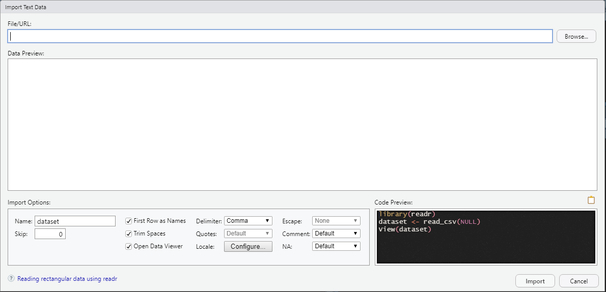

```{r setup, include=F}
#| label: setup
#| include: false


library(quarto)
library(fontawesome)
library(tidyverse)
```


## Archivos de datos {.title-top}

- En el mundo informático existen numerosos formatos de archivos de tablas / base de datos.

- El lenguaje R permite importar y exportar de una amplia variedad de formatos a partir de utilizar diferentes paquetes. Muchos de ellos pertenecientes al ecosistema **tidyverse**.

- Hoy nos vamos a centrar en dos formatos básicos habituales donde tenemos almacenada comúnmente la información:
  - Archivos **texto plano separados por comas** u otro caracter (extensiones .csv, .txt, etc)
  - Archivos con formato **Excel** (.xls y .xlsx)

- Además mencionaremos otros formatos posibles y el propio de R

## Paquete readr {.title-top}

{fig-align="center" width="12%"}

El paquete **readr** se instala y activa cuando ejecutamos `library(tidyverse)`.

- Contiene una familia de funciones que permiten leer y escribir archivos de texto plano separados como coma o algún otro caracter (tabulación, punto y coma, etc)

- Sus funciones de lectura comienzan todas con **read_**

- Sus funciones de escritura comienzan con **write_**

<br>

## Lectura con funciones de readr {.title-top}

<br>

La primera función de lectura que vamos a presentar es `read_delim()`

El estructura de esta función sirve de base para las demás.

Sus principales argumentos son:

- **file**: nombre del archivo

- **delim**: caracter separador de columna

- **col_names**: Valor lógico. Si es *TRUE* lee la primera fila como nombres de las variables. Si es *FALSE* no lo hace.

- **skip**: número de líneas que saltea para comenzar a leer.

## Lectura con funciones de readr {.title-top}

<br>

La función tiene numerosos argumentos que nos permite controlar eficazmente la lectura, como vemos debajo, pero se suelen modificar pocos de ellos en la mayoría de las situaciones.

```{r}
#| echo: true

args(readr::read_delim)

```


## Lectura con funciones de readr {.title-top}

<br>

Para archivos separados por comas en formato regional Estadounidense se utiliza la función `read_csv()`.

Tiene la misma base de `read_delim()` pero asume:

- que el caracter delimitador es la `coma` ","
- que el caracter separador de coma decimal es el `punto` "."

```{r}
#| echo: true
#| eval: false

read_csv(file = "datos.csv")
```

## Lectura con funciones de readr {.title-top}

<br>

Para archivos separados por comas en formato regional Español/Argentino se utiliza la función `read_csv2()`.

Tiene la misma base de `read_delim()` pero asume:

- que el caracter delimitador es el `punto y coma` ";"
- que el caracter separador de coma decimal es la `coma` ","

```{r}
#| echo: true
#| eval: false

read_csv2(file = "datos.csv")
```

## Lectura de múltiples archivos {.title-top .smaller}

<br>

En ocasiones trabajamos con múltiples archivos que tienen una misma estructura interna, por ejemplo provenientes de proyectos longitudinales de vigilancia epidemiológica. Supongamos que tenemos el caso de vigilancia de una enfermedad donde se produce un archivo por mes, tipo `01_SUH.csv`, `02_SUH.csv`, `03_SUH.csv`, etc hasta el mes 12.

Podemos almacenar los nombre de los archivos en un vector y luego leerlos todos juntos, incorporando la identificación del archivo.

```{r}
#| eval: false
#| echo: true


archivos_SUH <- c("datos/01-SUH.csv", "datos/02-SUH.csv", "datos/03-SUH.csv")
read_csv(archivos_SUH, id = "archivo")

#>   archivo           mes     anio   ID    edad  
#>   <chr>             <chr>   <dbl>  <dbl> <dbl>
#> 1 datos/01-SUH.csv Enero  2019     1234     3
#> 2 datos/01-SUH.csv Enero  2019     8721     9
#> 3 datos/01-SUH.csv Enero  2019     1822     2
```


## Herramienta de lectura de RStudio {.title-top}

<br>

{fig-align="center"}


## Paquete readxl {.title-top}

{fig-align="center" width="12%"}

El paquete **readxl** se instala con tidyverse pero hay que activarlo aparte mediante `library(readxl)`.

- Contiene funciones que permiten leer archivos de Microsoft Excel tan extendidos en nuestro trabajo cotidiano.

- La función comodín para leer, tanto formatos .xls como .xlsx, es `read_excel()`

- Ver documento [Data Organization in Spreadsheets](https://www.tandfonline.com/doi/full/10.1080/00031305.2017.1375989)

## Lectura con funciones de readxl {.title-top}

<br>

La estructura de los argumentos de la función `read_excel()` es:


- **path**: nombre del archivo

- **sheet**: hoja del libro del archivo Excel

- **range**: rango de celdas (opcional)

- **col_names**: Valor lógico. Si es *TRUE* lee la primera fila como nombres de las variables. Si es *FALSE* no lo hace.

- **skip**: número de líneas que saltea para comenzar a leer.

## Paquete haven {.title-top}

{width=12% fig-align="center"}

Este paquete permite la importación de archivos provenientes de paquetes estadísticos como SPSS (.sav), Stata (.dta) y SAS (.sas7bdat) y también su exporatción.

- Sus funciones principales son `read_spss()`, `read_por()`, `read_stata()`, `read_dta()`, `read_sas()`  

- Las funciones de exportación comienzan con el prefijo `write_`

- Tiene algunas limitaciones dependiendo de las versiones de los softwares.

## Características argumentales comunes  {.title-top}

<br>
<br>

::: incremental

- Adivinación de tipo de datos (que tipo de dato contiene cada columna)

- Valores que consideramos como faltantes (argumento **na**)  

- Tipo de columna que queremos forzar al leer (argumento col_types) 

:::


## Apache Parquet (arrow) {.title-top}

<br>

Cuando los archivos csv superan los 50 MB a 100 MB, o cuando rebasan los 500.000 a 1.000.000 de filas conviene usar formatos de archivo Parquet. 

Apache Parquet es un formato de archivo columnar diseñado específicamente para el almacenamiento y procesamiento eficiente de datos estructurados.

A diferencia de los archivos cvs o Excel, que guardan los datos por filas (como una tabla de texto tradicional), Parquet organiza y almacena los datos agrupados por columnas.

El paquete que permite gestionarlos en R se llama (paquete [arrow](https://arrow.apache.org/docs/r/))

## Apache Parquet (arrow) {.title-top}

Sus ventajas principales son:


::: incremental
- **Compresión avanzada**: Los datos ocupan mucho menos espacio en disco (puede llegar a ocupar un 70% menos que un csv).

- **Velocidad de lectura**: Es muy eficiente y veloz

- **Preservación de tipos de datos**: A diferencia de los csv —donde al reabrir el archivo a menudo pierdes la noción de si una columna era fecha, entero o factor— Parquet guarda internamente el tipo de dato exacto (números, textos, booleanos, fechas).

- **Particionamiento**: Permite dividir grandes volúmenes de datos en carpetas organizadas por categorías (por ejemplo, año o región), lo que acelera exponencialmente las consultas filtradas.
:::

## Otros formatos online y bases de datos {.title-top}

<br>


::: incremental

- Lectura y escritura de archivos en Google Sheets (paquete [googlesheets4](https://googlesheets4.tidyverse.org/))

- Conexión a bases de datos tipo SQL (paquetes [DBI](https://cran.r-project.org/web/packages/DBI/index.html) y [dbplyr](https://dbplyr.tidyverse.org/))

- Otros: webcrapping, datos jerarquico (json -JavaScript Object-), etc 

:::

## Formato nativo R {.title-top}

<br>

El propio lenguaje R tiene un formato nativo de almacenamiento del entorno de trabajo produciendo archivos con extención `.RData`.

Las funciones, pertenecientes a R base, para guardar y leer los `.RData` son:

- `save()`: almacena el contenido del entorno de trabajo, pudiendo seleccionar cual o cuales objetos deseamos guardar.

- `load()`: lee archivos `.RData` y su contenido (sea este uno o varios objetos)

Cabe aclarar que cuando nos referimos a objetos estamos hablando de cualquier estructura de datos como dataframes, vectores, matrices, etc y también funciones propias. 

## Documentación {.invert}

<br>

{width="15%" fig-align="center"}

::: {.centered}

Capítulo 7 del libro ["R for Data Science (2e)"](https://r4ds.hadley.nz/data-import)

:::