## GitHub {.title-top}

<br>

- Es un sitio web que ofrece un servicio para almacenar repositorios en base a control de versiones que se integra con Git.

- Se utiliza principalmente para alojar código y fuente de productos digitales (material educativo, libros, etc)

- Fue desarrollado en 2008 y actualmente pertenece a Microsoft

- Es de acceso gratuito y tiene también planes de pago con servicios especiales (mayor cantidad de colaboradores en repositorios privados, por ejemplo)

## Crear cuenta {.title-top}

<br>

Necesitamos ingresar:

1.  Dirección de correo electrónico (email)

2.  Contraseña (password)

3.  Nombre de usuario (username)

4.  Debemos verificar que somos humanos

5.  Listo (Crear cuenta)

## Paso 1 {.title-top}

{fig-align="center"}

## Paso 2 {.title-top}

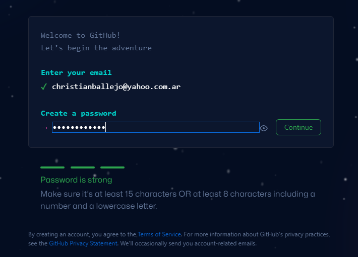{fig-align="center"}

## Paso 3 {.title-top}

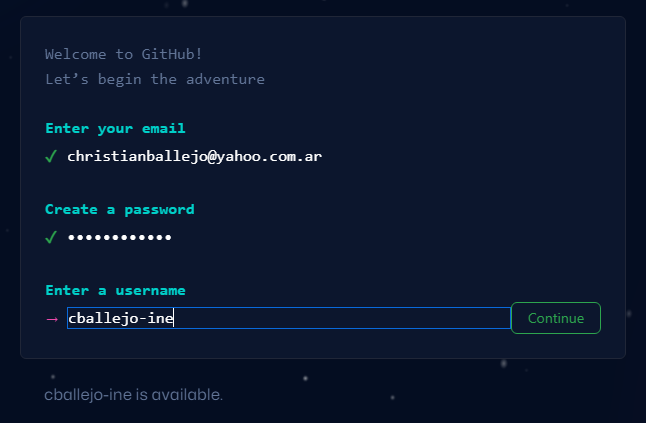{fig-align="center"}

## Paso 4 {.title-top}

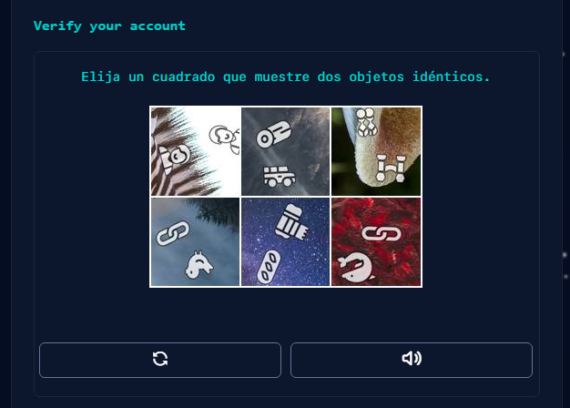{fig-align="center"}

## Paso 5 {.title-top}

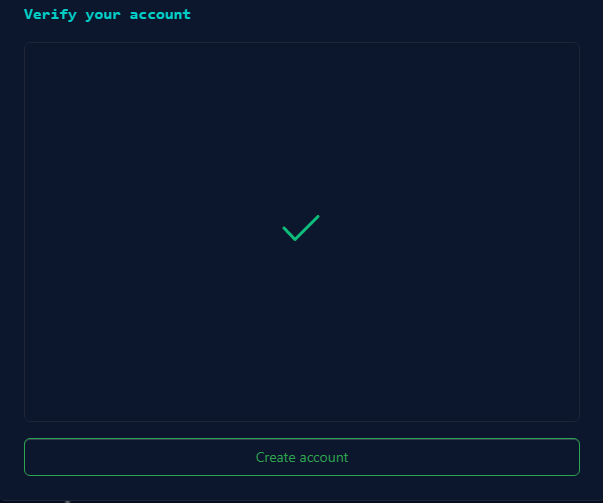{fig-align="center"}

## Verificación {.title-top}

Nos va a llegar un código de verificación a nuestra cuenta de correo electrónico declarada, que debemos ingresar en la siguiente pantalla:

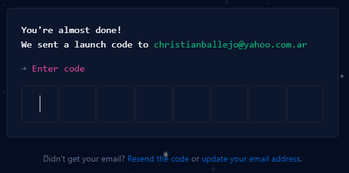{fig-align="center"}

## Últimos pasos {.title-top}

A partir de aquí, nos dan la bienveniva y sigue una serie de consultas sobre el uso que le pensamos dar a nuestra cuenta en GitHub.

Por ejemplo: ¿Qué características específicas le interesa utilizar?

{fig-align="center"}

## Finalmente {.title-top}

Nos ofrece la versión paga o continuar con la gratuita.

{fig-align="center"}

## Estamos dentro de GitHub {.title-top}

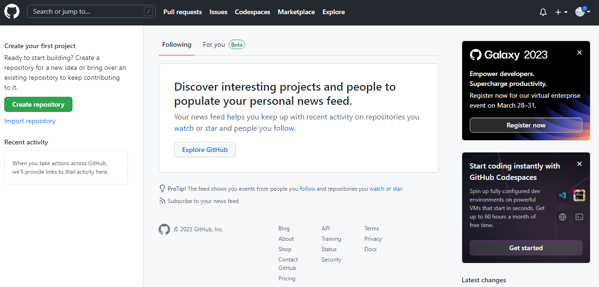{fig-align="center"}

## Personalizar cuenta en GitHub {.title-top}

<br>

Podemos ir a [Your Profile (github.com)](https://github.com/settings/profile) para personalizar el perfil publico de la cuenta y definir:

- Nombre

- Biografía

- URL de sitio web (si tiene)

- Compañia

- Ubicación

## Token de acceso {.title-top}

- Cuando interactuamos con GitHub, debemos incluir credenciales en la solicitud. Esto demuestra que somos un usuario específico de GitHub, que puede hacer lo que le pidamos.

- Git puede comunicarse con un servidor remoto usando uno de dos protocolos, HTTPS o SSH, y los diferentes protocolos usan credenciales diferentes.

- HTTPS más fácil de usar y es el que recomienda el mismo GitHub para usuarios Windows. Si quiere saber mas de SSH puede ver <https://happygitwithr.com/ssh-keys.html>

- Este token se denomina **PAT** *(**personal access token**)*

## Token de acceso {.title-top}

<br>

::: incremental
- Para crear un nuevo token vaya a [Personal access tokens](https://github.com/settings/tokens)
- Pulse sobre [Generate a personal access token](https://github.com/settings/tokens/new)
- Escriba *RStudio* en **Note**
- Seleccione al menos los alcances (*scopes*) de **repo**, **workflow** y **user**.
- Finalmente presione en ***generate token***
:::

## Token de acceso {.title-top}

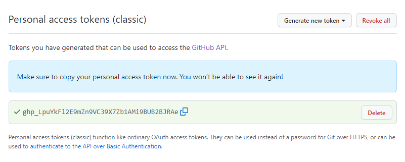{fig-align="center"}

Debemos copiar el token PAT ahora porque no podremos volver a verlo. (Tratemos este token como una contraseña!!).

## Paquete gitcreds {.title-top}

Gestiona credenciales git almacenadas (administra tokens GitHub, entre otros)

1.  Instalamos el paquete **gitcredits**
2.  Ejecutemos la siguiente función:

```{r}
#| eval: false
#| echo: true
gitcreds::gitcreds_set()
```

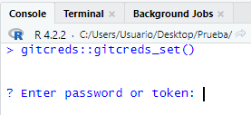{fig-align="center" width="50%"}

3.  Pegamos el token PAT generado GitHub

<br>

<br>

## Paquete gitcreds {.title-top}

4.  Veremos una salida similar a la siguiente:

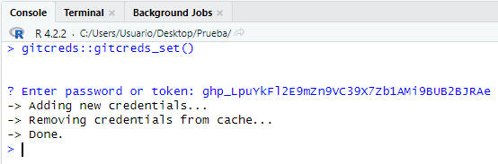{fig-align="center" width="45%"}

5.  Si queremos chequear podemos ejecutar `gitcreds::gitcreds_get()`

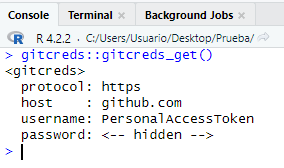{fig-align="center" width="25%"}

## Repositorios en GitHub {.title-top}

<br>

Existen varias formas de crear y vincular repositorios de GitHub con nuestros proyectos en RStudio.

- Proyecto existente -\> luego GitHub

- Proyecto existente -\> primero GitHub

- Proyecto nuevo -\> primero GitHub

## Proyecto existente -\> luego GitHub {.title-top}

<br>

Desde RStudio y con el proyecto con Git habilitado, vamos a utilizar la función `use_github()` del paquete **usethis**.

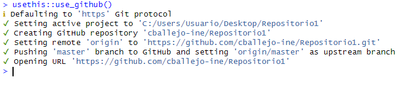{fig-align="center"}

Esta acción necesita de nuestras credenciales (token) pero al haberlo almacenado con **gitcreds** lo hace automáticamente.

## Proyecto existente -\> primero GitHub {.title-top}

1.  Dentro del sitio buscamos el signo + en la parte superior del menú y seleccionamos **New repository**

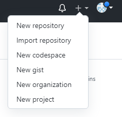{fig-align="center"}

<br>

<br>

## Proyecto existente -\> primero GitHub {.title-top}

2.  Completamos la información de: Repository name y Descripcion (opcional) con el mismo nombre de nuestro proyecto.

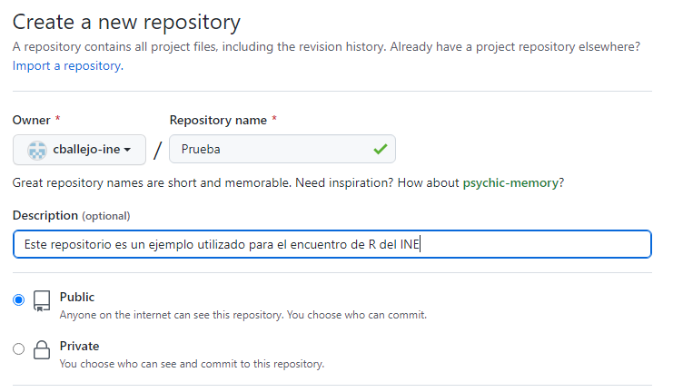{fig-align="center"}

## Proyecto existente -\> primero GitHub {.title-top}

3.  Finalmente pulsamos en el botón de **Create repository**

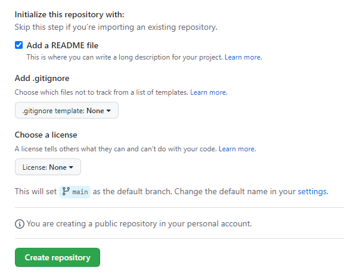{fig-align="center"}

## Proyecto existente -\> primero GitHub {.title-top}

4.  GitHub nos ofrece una serie de opciones para vincular este repositorio con uno local (en nuestro equipo).

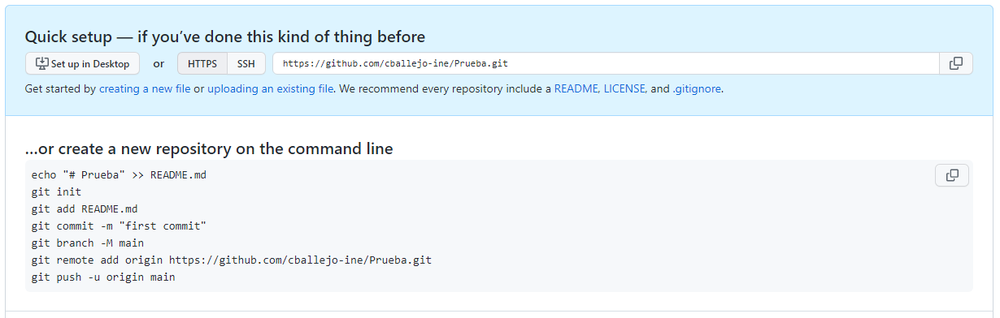{fig-align="center" width="100%"}

## Proyecto existente -\> primero GitHub {.title-top}

5.  Vamos a usar y copiar al portapapeles la segunda de ellas (*... or push an existing repository from the command line*)

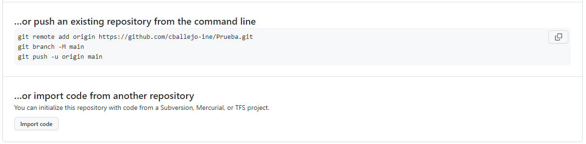{fig-align="center" width="100%"}

## Proyecto existente -\> primero GitHub {.title-top}

6.  Pasamos a RStudio con el proyecto abierto y pegamos los comandos copiados dentro de la pestaña Terminal.

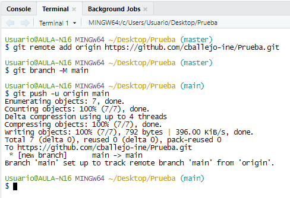{fig-align="center" width="50%"}

## Proyecto nuevo -\> primero GitHub {.title-top}

Si el proyecto no existe, podemos comenzar creando un repositorio en GitHub y luego crear un nuevo proyecto desde RStudio conectado directamente.

1.  Hacemos todos los pasos para crear un nuevo repositorio en GitHub y copiamos la URL HTTPS que nos ofrece (termina en .git) en **Code**.

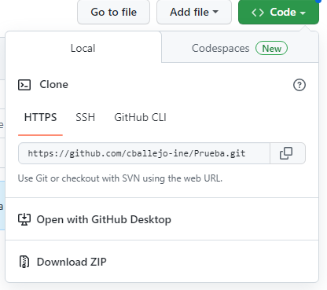{fig-align="center"}

## Proyecto nuevo -\> primero GitHub {.title-top}

2.  En RStudio creamos un proyecto nuevo con Control de versiones.

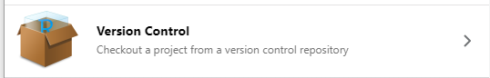{fig-align="center"}

3.  Seleccionamos la opcion GIT.

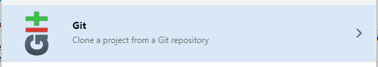{fig-align="center"}

## Proyecto nuevo -\> primero GitHub {.title-top}

4.  Pegamos la dirección URL en el espacio "Repository URL", ponemos el mismo nombre que el repositorio GitHub y finalmente seleccionamos en que lugar queremos que construya la carpeta.

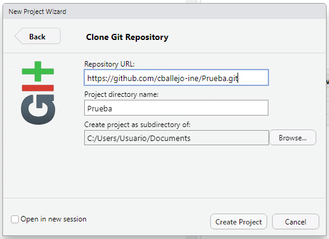{fig-align="center"}

## Resumen {.title-top}

<br>

::: incremental
1.  Instalar **R** y **RStudio** en sus versiones actualizadas
2.  Instalar **Git**
3.  Instalar el paquete **usethis** en RStudio
4.  Configurar Git con nuestro **nombre** y **mail** a partir de `usethis::edit_git_config()`
5.  Crear **proyecto** en RStudio y vincularlo con **Git** a partir de `usethis::use_git()`
:::

## Resumen {.title-top}

<br>

::: incremental
6.  Crear una cuenta en **GitHub** con el **mismo mail** que configuramos en **Git**.

7.  Crear un **token (PAT)** desde GitHub y copiarlo.

8.  Instalar el paquete **gitcreds** en RStudio

9.  Almacenar el token (PAT) con `gitcreds::gitcreds_set()`

10. Subir y crear repositorio en GitHub mediante `use_github()`
:::