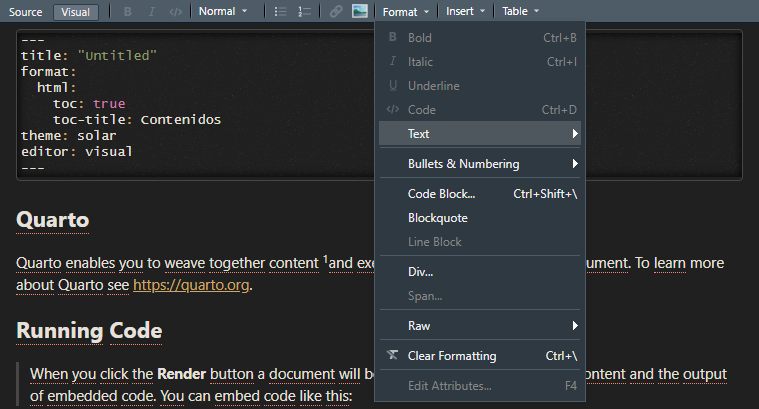

```{r setup, include=F}
library(quarto)
library(fontawesome)
library(tidyverse)
```


## Qué es Quarto®? {.title-top}

<br>

> **Quarto® es un nuevo sistema de publicación científica y técnica de código abierto construido sobre [Pandoc](https://pandoc.org/)** [^1]

[^1]: conversor de documentos libre y de código abierto, mayormente usado como una herramienta de escritura (especialmente por académicos) ver en [Wikipedia](https://es.wikipedia.org/wiki/Pandoc)

. . .

> Mezcla texto narrativo y código para producir resultados con un formato elegante en documentos, tableros interactivos, páginas web, publicaciones de blogs, libros y más.

. . .

> Es independiente del lenguaje R (incluso trabaja con otros lenguajes como Python y Julia).

## Como funciona Quarto? {.title-top .centrado}

<br>

::: {.fragment .fade-in-then-semi-out}

Se instala su software de forma independiente que conecta con `knitr` o `jupyter` como motor para ejecutar código y generar una salida temporal (**.md**).

:::

::: {.fragment .fade-in-then-semi-out}

El archivo temporal se procesa mediante los filtros **Lua** de `Pandoc` y `Quarto`. Luego dependiendo el formato de salida lo hace con `Bootstrap CSS` para **HTML** o `LaTeX` para **PDF**, por ejemplo.
:::

::: {.fragment .fade-in-then-semi-out}

Los filtros Lua escritos por desarrolladores de `R`/`Python`/`Julia` son intercambiables entre formatos.

:::

::: {.fragment .fade-in-then-semi-out}

Quarto además incluye soporte nativo para `Observable JS`, un conjunto de mejoras a JavaScript básico creado por *Mike Bostock* (también autor de `D3`).

:::

::: {.fragment .fade-in-then-semi-out}

Observable JS se distingue por su tiempo de ejecución reactivo, que es 
especialmente adecuado para la exploración y el análisis de datos interactivos.

:::

## Características {.title-top}

::: incremental

- Es un software con interfaz de *línea de comandos* (**CLI**) que se integra con RStudio.

- Tiene múltiples formatos modernos de salidas unificado la funcionalidad de muchos paquetes del anterior ecosistema R Markdown (rmarkdown, bookdown, distill, xaringan, etc.)

- Implementa funciones más atractivas y útiles en todos los productos: pestañas, resaltado de sintaxis, diagramas, etc.

- Se pueden renderizar los documentos viejos `.rmd` (RMarkdown) o `.ipynb` (cuadernos jupyter de python) con Quarto.

- Además de RStudio, viene incluido en otros editores como VS Code y Positron.

- Soporta `htmlwidgets` en R y Jupyter widgets para Python/Julia además de Observable JS

:::

## Software Quarto {.title-top .centrado}

<br>

-   El sitio web de `Quarto` es <https://quarto.org/>

-   La **versión actual** es 1.10.19 (Windows) del 06/10/2026

-   La **guía oficial** se puede encontrar en <https://quarto.org/docs/guide/>

-   **RStudio Desktop** incluye una versión de Quarto en su instalación desde la versión 2022.07.01 pero conviene actualizarlo de forma independiente

## Anatomia de un `.qmd` {.title-top .smaller}

. . .

Al igual que los **.Rmd** de **RMarkdown** el archivo fuente de `Quarto` es de texto plano

. . .

Tiene una cabecera `YAML` con metadatos 


:::: {.columns style="font-size: 50px;"}

::: {.column width="45%"}

``` yaml
format: html
engine: knitr
```

:::

::: {.column width="55%"}

``` yaml
format: html
engine: jupyter
```

:::

::::

. . . 

Suele tener código incluido


:::: {.columns style="font-size: 50px;"}

::: {.column width="45%"}

````code
```{{r}}
library(dplyr)
mtcars |> 
  group_by(cyl) |> 
  summarize(mean = mean(mpg))
```
````

:::

::: {.column width="55%"}

````code
```{{python}}
from siuba import *
(mtcars
  >> group_by(_.cyl)
  >> summarize(avg_mpg = _.mpg.mean()))
```
````

:::

::::

. . .

Y texto narrativo

::: {style="font-size: 50px;"}
``` markdown
# Cabecera 1
Esto es texto en **negrita**, esto en *itálica* y esta otra una 
{fig-alt="Texto alternativo para esta imagen"}.
```

:::

## Ejemplo de un .qmd {.title-top}

Los archivos `.qmd` responden estructuralmente al modelo de programación literaria ([Literate programming](https://es.wikipedia.org/wiki/Programaci%C3%B3n_literaria))

<br>

    ---
    title: "ggplot2"
    date: "18/04/2024"
    format: html
    ---

    ## Calidad del aire

    Esta es la relación entre la temperatura y el nivel de ozono.

    ```{{r}}
    #| label: fig-calidad_aire
    library(ggplot2)
    ggplot(airquality, aes(Temp, Ozone)) + 
      geom_point() + 
      geom_smooth(method = "loess"
    )
    ```


## Metadatos: YAML {.title-top}

. . . 

<br>

- Los metadatos que se definen en el encabezado YAML (estándar de serialización de datos amigable para humanos para todos los lenguajes de programación) que todos los archivos `.qmd` tienen son procesados en muchas etapas del renderizado y puede influir en el documento final de varias formas. 

. . . 

- Siempre se colocan al principio del documento y lo lee **Pandoc**, **Quarto** y **knitr**. 

. . . 

- En su recorrido, la información que contiene suele afectar el código, el contenido y el proceso de renderizado.

. . . 

- Muchas de las opciones de código YAML para Quarto se pueden encontrar en su [documentación](https://quarto.org/docs/reference/)  

## Texto y otros elementos {.title-top}

. . . 

<br>

- `Quarto` se basa en **Pandoc** y utiliza su variación de [Markdown](https://es.wikipedia.org/wiki/Markdown) como sintaxis para documentos. 

. . . 

- El **Markdown** de Pandoc es una versión ampliada y ligeramente revisada de la sintaxis Markdown de [John Gruber](https://en.wikipedia.org/wiki/John_Gruber).

. . . 

- Markdown es un lenguaje de marcas sencillo diseñado para ser fácil de escribir y, lo que es más importante, fácil de leer.

. . . 

- Es el mismo que se utiliza en el formato anterior de RMarkdown (archivos .Rmd)

## Código {.title-top .smaller}

. . . 

- El código se puede insertar a través de chunks (fragmentos) en distintos lenguajes

````code
```{{r}}
#| Aquí van los metadatos con las opciones de ejecución

Aquí va el código
```
````
. . . 

- Las opciones de ejecución del código incluido dentro de estos fragmentos se realiza mediante metadatos con el formato #|

. . . 

- Se pueden definir opciones de salida, figura, procesado, etc. Ver [guía](https://quarto.org/docs/computations/execution-options.html).

. . . 

- También se puede incluir [código en línea](https://quarto.org/docs/computations/inline-code.html) en el texto. 

```{r}
#| echo: false

casos <- 10
```


````code
```{{r}}
casos <- 10
```
````
(La cantidad de casos fue de \`\{r\ casos}\`). La cantidad de casos fue de `{r} casos`

## Algunos ejemplos para visualizar {.title-top}

::: columns
::: {.column width="50%"}

<br>

- [HTML paginado -estilo Tufte-](https://quarto-dev.github.io/quarto-gallery/page-layout/tufte.html)

- [Presentación revealjs](https://apreshill.github.io/palmerpenguins-useR-2022/)

- [Libro web](https://r4csr.org/)

- [Sitio web](https://sta210-s22.github.io/website/)

- [Documentos interactivos -shiny-](https://jjallaire.shinyapps.io/diamonds-explorer/)

- [Tableros](https://mine-cetinkaya-rundel.github.io/ld-dashboard/)

:::

::: {.column width="50%"}

<br>

{width="80%"}

:::

:::

## Cabecera YAML {.title-top}

<br>

``` yaml
---
format: html
---
```

. . .

``` yaml
---
format: pdf
---
```

. . .

``` yaml
---
format: typst
---
```

`typst` es un [nuevo sistema de composición tipográfica](https://typst.app/docs/) basado en marcas para ciencia.

. . .

Se le pueden agregar opciones. Las opciones deben estar debajo del formato principal (los espacios son importante y hay que respetarlos -identación-)


## YAML es sensible a la identación {.title-top}

:::: columns
::: {.column width="70%"}
``` yaml
---
format:html # invalido, falta espacio luego de :
---

---
format: # invalido, se lee como formato ausente
html
---

---
format: 
  html: # valido pero necesita de opciones posteriores
---
```

El formato válido puede ser diferente según lo que se necesite.

``` yaml
format: html # valido - hay espacio

# valido - formato con opciones
format: 
  html:
    toc: true
```
:::

::: {.column width="30%"}
{.r-stretch}
:::
::::

## Opciones YAML comunes para HTML {.title-top}

| Opción | Valores comunes | Qué hace |
|---|---|---|
| `theme` | `cosmo`, `flatly`, `darkly`, `[cosmo, styles.scss]`, `{light: ..., dark: ...}` | Tema Bootswatch y/o archivos SCSS propios; permite modo claro/oscuro |
| `css` | `estilos.css` | Agrega hojas de estilo CSS adicionales |
| `toc` | `true` / `false` | Muestra la tabla de contenidos |
| `toc-depth` | `2`, `3`, `4` | Niveles de encabezado incluidos en la tabla de contenidos |
| `toc-location` | `left`, `right`, `body` | Ubicación de la tabla de contenidos |

## Opciones YAML comunes para HTML {.title-top}

| Opción | Valores comunes | Qué hace |
|---|---|---|
| `number-sections` | `true` / `false` | Numera los encabezados |
| `code-fold` | `true` / `false` / `show` | Pliega el código; `show` lo deja abierto pero plegable |
| `code-summary` | `"Ver código"` | Texto del botón de código plegado |
| `code-tools` | `true` / `false` | Menú para ver el código fuente completo o descargarlo |
| `code-copy` | `true` / `false` / `hover` | Botón para copiar el código |
| `code-line-numbers` | `true` / `false` | Numera las líneas de código |

## Opciones YAML comunes para HTML {.title-top}

<br>

| Opción | Valores comunes | Qué hace |
|---|---|---|
| `code-overflow` | `scroll` / `wrap` | Qué hacer con líneas de código muy largas |
| `highlight-style` | `github`, `arrow`, `monokai` | Estilo de resaltado de sintaxis |
| `df-print` | `default`, `kable`, `tibble`, `paged` | Cómo se imprimen los data frames |
| `embed-resources` | `true` / `false` | Genera un único `.html` autocontenido (imágenes, CSS, JS) |

## Opciones YAML comunes para HTML {.title-top}

| Opción | Valores comunes | Qué hace |
|---|---|---|
| `page-layout` | `article`, `full`, `custom` | Distribución general de la página |
| `lang` | `es`, `en` | Idioma del documento (etiquetas, fechas, referencias) |

```yaml
---
title: "Mi informe"
format:
  html:
    theme: cosmo
    toc: true
    code-fold: true
    embed-resources: true
---
```

## Lenguaje de documentación: markdown {.title-top}

<br>

Inicialmente y para el uso general conviene aprovechar el `modo Visual` de RStudio para incorporar marcas de lenguaje Markdown. Prácticamente todos los elementos incorporados con formato markdown aplican en los diferentes formatos de salida (HTML, pdf, etc)

{.absolute top="400" left="400" width="1100"}

## Lenguaje de documentación: markdown {.title-top}

Algunas de las posibilidades integradas son:

::: incremental

- Atributos de texto (negritas, italicas, etc)
- Figuras
- Listas y tablas
- Enlaces web
- Diagramas
- Pestañas
- Bloques de llamada
- Videos embebidos
- Formulas matemáticas
- Citas bibliográficas


:::


## Fragmentos de código (chunk) {.title-top}

<br>

En todo documento Quarto se puede incluir código de diferentes lenguajes de programación (R, python, julia, javascript, etc) que soporte el editor y se encuentre instalado en la PC.

. . .

<br>

Habitualmente el código sirve para mostrar resultados estadísticos en forma de tabla y/o gráfico. Otras veces el código produce diversas tareas que no se muestran hasta tanto se produzca la salida de resultados. Y en ocasiones, cuando el producto tiene un fin docente sobre el lenguaje de programación en si, se muestran las líneas de código junto a lo que produce.

. . . 

<br>

Toda la ejecución del código se maneja desde las opciones de ejecución que se configuran como metadatos dentro de los fragmentos (chunks).

## Opciones de codificación {.title-top}

Las opciones de ejecución de los fragmentos de código se escriben dentro del chunk con el prefijo `#|`.

| Opción | Valores comunes | Qué hace |
|---|---|---|
| `label` | `fig-curva`, `tbl-resumen` | Nombre del chunk; con prefijo `fig-` / `tbl-` permite referencias cruzadas |
| `echo` | `true` / `false` / `fenced` | Muestra u oculta el código; `fenced` muestra también el delimitador del chunk |
| `eval` | `true` / `false` / `!expr condicion` | Ejecuta o no el código; admite una condición (p. ej. `!expr params$mostrar`) |

## Opciones de codificación {.title-top}

| Opción | Valores comunes | Qué hace |
|---|---|---|
| `include` | `true` / `false` | `false` ejecuta el código pero no muestra ni el código ni los resultados |
| `output` | `true` / `false` / `asis` | Muestra o no la salida; `asis` la interpreta como Markdown/HTML crudo |
| `warning` | `true` / `false` | Muestra u oculta las advertencias |
| `message` | `true` / `false` | Muestra u oculta los mensajes (p. ej. de paquetes) |
| `error` | `true` / `false` | `true` continúa el renderizado aunque haya un error y lo muestra |


## Opciones de codificación {.title-top}

| Opción | Valores comunes | Qué hace |
|---|---|---|
| `cache` | `true` / `false` | Guarda los resultados para no recalcular en cada render |
| `fig-cap` | `"Casos por semana"` | Epígrafe de la figura |
| `fig-alt` | `"Descripción de la figura"` | Texto alternativo (accesibilidad) |
| `fig-width` / `fig-height` | `7` / `4` (pulgadas) | Tamaño de la figura al generarla |
| `fig-align` | `left`, `center`, `right` | Alineación de la figura |

## Opciones de codificación {.title-top}

| Opción | Valores comunes | Qué hace |
|---|---|---|
| `out-width` | `"80%"`, `"500px"` | Ancho de la figura en el documento |
| `tbl-cap` | `"Resumen del período"` | Epígrafe de la tabla |
| `layout-ncol` | `2`, `3` | Coloca varias salidas en columnas |
| `code-fold` | `true` / `false` | Pliega el código de este chunk |
| `code-summary` | `"Ver código"` | Texto del botón de este chunk |
| `column` | `page`, `screen`, `margin` | Ancho que ocupa la salida respecto del texto |

## Ejemplo: opciones de codificación {.title-top}

<br>

```r
#| label: fig-curva
#| echo: false
#| fig-cap: "Curva epidémica semanal"
#| fig-width: 8
grafico_curva_epi(semanal)
```

Para aplicar una opción a todo el documento, se declara una vez bajo `execute:` en opciones de cabecera YAML:

```yaml
execute:
  echo: false
  warning: false
  message: false
```

## Opciones de renderizado {.title-top}

### Desde la línea de comandos (`quarto render`)

| Opción | Ejemplo | Qué hace |
|---|---|---|
| `--to` | `quarto render doc.qmd --to html` | Formato de salida |
| `--output` | `--output informe.html` | Nombre del archivo generado |
| `-P` / `--execute-param` | `-P jurisdiccion:Córdoba` | Pasa un parámetro al documento |
| `--execute-params` | `--execute-params params.yml` | Pasa varios parámetros desde un archivo |

## Opciones de renderizado {.title-top}

| Opción | Ejemplo | Qué hace |
|---|---|---|
| `--no-execute` | `quarto render doc.qmd --no-execute` | Renderiza sin ejecutar el código |
| `--cache-refresh` | `--cache-refresh` | Fuerza recalcular los resultados en caché |
| `--profile` | `--profile interno` | Usa un perfil de proyecto (`_quarto-interno.yml`) |
| `--execute-dir` | `--execute-dir .` | Directorio desde el que se ejecuta el código |

## Opciones de renderizado {.title-top}

### En el YAML del documento o del proyecto

| Opción | Dónde | Valores comunes | Qué hace |
|---|---|---|---|
| `output-file` | documento | `"informe.html"` | Nombre del archivo de salida |
| `output-dir` | `project:` | `output`, `docs` | Carpeta donde se guardan los resultados |
| `render` | `project:` | `[boletin.qmd]` | Lista de archivos que se renderizan en el proyecto |
| `execute-dir` | `project:` | `file` / `project` | Si el código corre desde la carpeta del archivo o de la raíz |


## Opciones de renderizado {.title-top}

| Opción | Dónde | Valores comunes | Qué hace |
|---|---|---|---|
| `freeze` | `execute:` | `auto`, `true`, `false` | No re-ejecuta el código salvo que el archivo cambie (`auto`) o nunca (`true`) |
| `fig-format` | formato | `png`, `svg`, `pdf` | Formato de las figuras |
| `fig-dpi` | formato | `96`, `300` | Resolución de las figuras |
| `fig-width` / `fig-height` | formato | `7` / `5` | Tamaño de figura por defecto para todo el documento |

## Ejemplos: Opciones de renderizado {.title-top}

<br>

En cabecera YAML:

```yaml
project:
  type: default
  output-dir: output
  render:
    - boletin.qmd
execute:
  freeze: auto
```

<br>

En Terminal:

```bash
quarto render boletin.qmd --output boletin.html
```

## Proyectos Quarto {.title-top}
 
<br>
 
A diferencia de un documento Quarto, un proyecto es una carpeta de trabajo que organiza varios documentos, recursos y configuración compartida. 

El directorio contiene, como mínimo:

- Un archivo de configuración `_quarto.yml`.

- Uno o varios documentos Quarto.

- Recursos asociados: imágenes, datos, estilos, bibliografía, etc.
 
. . .

Se suele usar para sitios web, libros digitales y blogs, por ejemplo y se renderiza como un conjunto: `quarto render` en la Terminal

## Proyectos Quarto {.title-top}

<br>

:::: columns
::: {.column width="50%"}

Ejemplo de estructura de un directorio 

<br>

```
mi-sitio/
├── _quarto.yml
├── index.qmd
├── about.qmd
├── posts/
│   └── primer-post.qmd
└── styles.css 
```  
:::

::: {.column width="50%"}

Una cabecera YAML en `_quarto.yml` podría ser:

<br>

```
project:
  type: website

website:
  title: "Mi sitio"
  navbar:
    left:
      - href: index.qmd
        text: Inicio
      - about.qmd
        text: Acerca de

format:
  html:
    theme: cosmo 
```

:::
::::
 
## Paquete quarto {.title-top}

<br>

El paquete **quarto** es una interfaz de R hacia la línea de comandos de Quarto.

Se usa generalmente para:

::: incremental

- Renderizar documentos Quarto desde R: por ejemplo, `quarto::quarto_render("informe.qmd")`.

- Automatizar la generación de documentos en scripts (muy útil para los informes que deseamos generar)

- Crear proyectos Quarto desde R: `quarto::quarto_create_project()`.

- Previsualizar documentos y sitios: `quarto_preview()`.

- Verificar la instalación de Quarto: `quarto_available()`, `quarto_path()`, `quarto_version()`.

:::