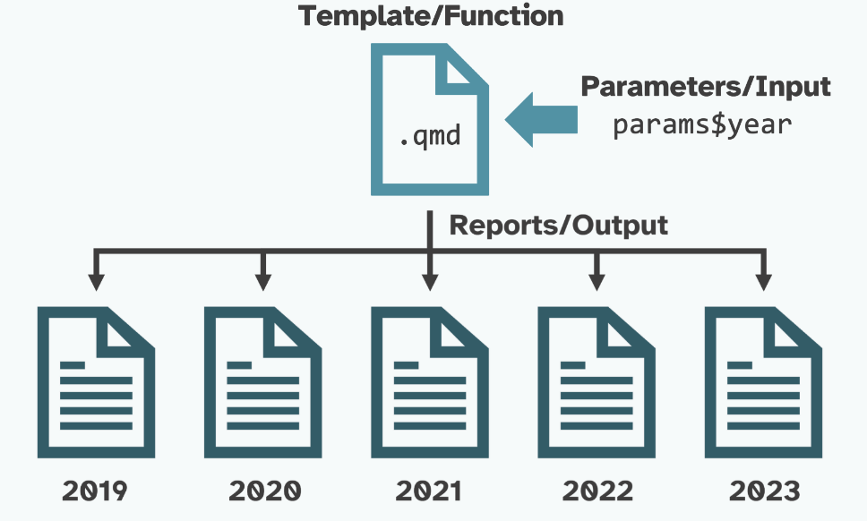

```{r setup, include=F}
library(quarto)
library(fontawesome)
library(tidyverse)
```


## El punto de partida: un informe monolítico {.title-top}

<br>

Un solo `.qmd` con todo mezclado: lectura, limpieza, cálculos, gráficos y texto.

```r
d <- read_csv2("../data/raw/sisa_covid_simulado.csv") |> 
  filter(clasificacion_resumen == "Confirmado") |> 
  filter(residencia_provincia_nombre == "Buenos Aires") |> 
  filter(fecha_apertura >= "2022-01-01",
         fecha_apertura <= "2022-12-31")
```

. . .

::: {.incremental}
- Para filtrar la provincia de **Córdoba**, por ejemplo, hay que copiar el archivo y cambiar el nombre de "Buenos Aires" en varios lugares
- Los errores son difíciles de ubicar
- El código de análisis no se puede reutilizar en otro informe
- Texto, cálculo y gráficos están enredados
- Para realizar un informe por provincia necesitamos 24 documentos `.qmd`
:::


## ¿Qué es un proyecto Quarto? {.title-top}

<br>

Una **carpeta** con un archivo `_quarto.yml` que contiene la configuración común.

::: {.incremental}
- Permite renderizar **varios documentos** con un solo comando
- **Comparte** opciones entre documentos (formato, estilo, ejecución)
- Puede **redirigir** los resultados a otra carpeta (`output/`)
- Puede **congelar** resultados para no recalcular
:::

. . .

> Un documento suelto se configura solo de forma independiente; un proyecto se configura **una vez** para todos los informes.

## Anatomía de nuestro proyecto {.title-top}

<br>

```text
boletin-covid/
├── _quarto.yml          # configuración común
├── boletin.qmd          # presentación + parámetros
├── render_todos.R       # un .qmd → muchos informes
├── R/                   # funciones de análisis
│   ├── 01_carga.R
│   ├── 02_limpieza.R
│   ├── 03_analisis.R
│   └── 04_graficos.R
├── data/
│   ├── raw/             # datos crudos
│   └── poblacion.csv
└── output/              # informes generados
```

## Separar análisis de presentación {.title-top}

<br>

**Regla:** el archivo `.qmd` presenta. El archivo `R/` calcula.

<br>

::: {.columns}
::: {.column width="50%"}
**Antes** (en el `.qmd`)

```r
d |>
  mutate(sem = floor_date(
    fecha_apertura, "week",
    week_start = 7)) |>
  count(sem) |>
  ggplot(aes(sem, n)) +
  geom_col()
```
:::

::: {.column width="50%"}
**Después**

```r
# en boletin.qmd
semanal <- casos_por_semana(casos)
grafico_curva_epi(semanal)
```
<br>

El cálculo vive en `R/03_analisis.R` y el gráfico en `R/04_graficos.R`.
:::
:::

## Funciones en archivos `.R`  {.title-top}


```r
# R/03_analisis.R
casos_por_semana <- function(casos) {
  casos |>
    dplyr::count(semana_inicio, name = "casos")
}
```

Y en el `.qmd` se cargan todas de una vez:

```r
walk(list.files("R", pattern = "\\.R$", full.names = TRUE), source)
```


**Características de las funciones:**

::: {.incremental}
- **Una función, una tarea**: cargar, limpiar, resumir o graficar
- Nombres claros: `leer_sisa()`, `limpiar_casos()`, `filtrar_casos()`
- Se pueden **probar sin Quarto**: `source()` y llamar a la función en consola
- Se reutilizan en cualquier informe del proyecto
:::

## El flujo del proyecto {.title-top}

<br>
<br>

```{mermaid}
%%| fig-width: 18
%%| fig-height: 2
flowchart LR
  A["Datos<br/>data/"] --> B["Funciones<br/>R/"]
  B --> C["Análisis<br/>resumen, tablas"]
  C --> D["Quarto<br/>boletin.qmd"]
  D --> E["Informe<br/>output/"]
```

. . .

Cada archivo del proyecto vive en **una sola etapa**. 

Si algo falla, sabemos dónde buscar.


## `_quarto.yml`: la configuración común {.smaller .title-top}

<br>

```yaml
project:
  type: default
  output-dir: output
  render:
    - boletin.qmd

format:
  html:
    theme: cosmo
    embed-resources: true

execute:
  echo: false
  warning: false
```

::: {.incremental}
- `project`: tipo, carpeta de salida y qué se renderiza
- `format`: opciones del formato de salida
- `execute`: cómo se ejecuta el código en **todos** los documentos
:::

## Parámetros: una plantilla, muchos informes  {.title-top}


<br>

{fig-align="center"}

## Parámetros: una plantilla, muchos informes  {.title-top}

Se declaran en el encabezado YAML del `.qmd` y tienen formato clave:valor. Se definen con un **valor por defecto**:

```yaml
---
title: "Boletín epidemiológico de COVID-19"
params:
  jurisdiccion: "Buenos Aires"
  fecha_desde: "2022-01-01"
  fecha_hasta: "2022-12-31"
---
```
::: {.incremental}
- Los valores válidos para los parámetros son cadenas de texto, números o valores booleanos.
- Reemplazan los valores escritos a mano en el código
- Se sobrescriben al renderizar
:::

## Acceder a `params` desde R {.title-top}

<br>

Dentro de un chunk, `params` es una **lista**:

```r
desde <- as_date(params$fecha_desde)
hasta <- as_date(params$fecha_hasta)

casos <- datos |>
  limpiar_casos() |>
  filtrar_casos(params$jurisdiccion, desde, hasta)
```

También en el texto, con código *inline*:

```{r}
#| echo: true
## `r params$jurisdiccion`
```

::: {.callout-warning}
## Ojo
Las **fechas llegan como texto**: hay que convertirlas con `as.Date()` o `as_date()`.

El **título del YAML** no evalúa código inline (la jurisdicción, por ejemplo, debe ir dentro de un encabezado en el cuerpo del `.qmd`.
:::

## Un `.qmd`, renderiza muchos informes {.title-top}

<br>

**Desde la terminal**, un informe por vez:

```bash
quarto render boletin.qmd -P jurisdiccion:Chubut --output boletin_chubut.html
```

**Desde un script de R**, un informe por jurisdicción:

```r
walk(jurisdicciones, renderizar_boletin)
```

::: {.incremental}
- Los pares clave-valor de tus parámetros definidos deben encontrarse en el conjunto de datos.
- La **plantilla** es siempre la misma, solo cambian los **parámetros**
- 24 jurisdicciones → 24 informes, sin copiar ni pegar
- Un error corregido en `R/` se corrige en **todos** los informes
:::

## Función `quarto_render()` de quarto

<br>

Renderiza desde código R un archivo `.qmd` definido como entrada al formato de salida especificado usando quarto.

```{r}
#| eval: false
#| echo: true

quarto::quarto_render(
  input =  "boletin.qmd", # Input archivo quarto 
  output_file = "output/Cordoba.html",
  execute_params = list(                        # Named list of params
    jurisdiccion: "Cordoba",
    fecha_desde: "2022-01-01",
    fecha_hasta: "2022-12-31"))
```

Se puede automatizar haciendo funciones o recorriendo un dataframe con tres columnas (formato de salida, nombre de archivo y parametros) y luego recorrer con `pwalk()`


## Dataframe para iterar {.smaller .title-top}

<br>

```{r}
#| eval: false
#| echo: true

reportes_jurisdicciones <- datos |> 
    distinct(residencia_provincia_nombre) |>  # jurisdicciones únicas
    mutate(
        output_file = paste(                  # nombres de archivos
            str_to_lower(residencia_provincia_nombre),
            "reporte.html",
            sep = "-"),
        execute_params = purrr::map(         # parametros tipo lista
            residencia_provincia_nombre,
            \(residencia_provincia_nombre) list(jurisdiccion = residencia_provincia_nombre, fecha_desde = "2022-01-01", fecha_hasta = "2022-12-31"))) |> 
  select(output_file, execute_params)       # seleccionamos solo columnas válidas
  

purrr::pwalk(
  .l = reportes_jurisdicciones,             # dataframe         
  .f = quarto::quarto_render,               # función a aplicar    
  input = "boletin.qmd",                    # .qmp fuente
  .progress = TRUE                              
)
``` 


 

## Hoja de ruta de la práctica {.title-top}

<br>

Partimos del informe monolítico y llegamos al proyecto con parámetros:

1. Ordenar la **estructura** de carpetas
2. Mover los bloques de código a **funciones** en `R/`
3. Dejar en el `.qmd` solo **llamadas** a funciones
4. Crear `_quarto.yml` con la **configuración común**
5. Reemplazar valores fijos por **parámetros**
6. Renderizar con **otros valores**
7. Generar **todos los informes** con un bucle

. . .

> Al terminar, ubicaremos cada archivo en el flujo: datos → funciones → análisis → Quarto → informe.

## Que vamos a encontrar en práctica de hoy {.title-top}

<br>

::: incremental
- Un proyecto Quarto con `_quarto.yml` con las caracteristicas generales de quarto (características del proyecto, formato de salida, opciones de ejecución de código, etc)
- Un archivo Quarto `boletin.qmd` (con la plantilla del boletín hecha en quarto y con el código que llama a las funciones necesarias para visualizar la información)
- Subcarpetas: `data`, `R` y `output` (donde en `data` tenemos los datos, en `R` los scripts con las funciones y en `output` almacenaremos los diferentes boletines que renderizamos)
- Un script `render_todos.R` (con el código para renderizar diferentes tipos de boletines)
:::

## Que vamos a encontrar en práctica de hoy {.title-top}

<br>

Dentro de la subcarpeta `R` tendremos los scripts:

- `00_librerías.R` con las activaciones de los paquetes y algunas utilidades generales como formatear la salida de numeros con decimales que usan coma decimal o construir nombres de archivos.

- `01_carga.R` con funciones de lectura de datos y validación de variables.

- `02_limpieza.R` con funciones de depuración de datos, creación de grupos etarios y definición de semanas epidemiológicas.

- `03_analisis.R` con funciones de analisis, conteo de casos, resumenes, tablas y texto automatizado que queremos incluir en el boletin.

- `04_graficos.R` con funciones de generación de gráficos (curva epidemica y piramide poblacional, en este ejemplo)