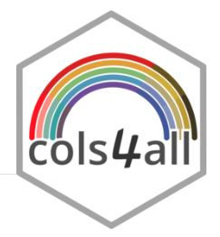
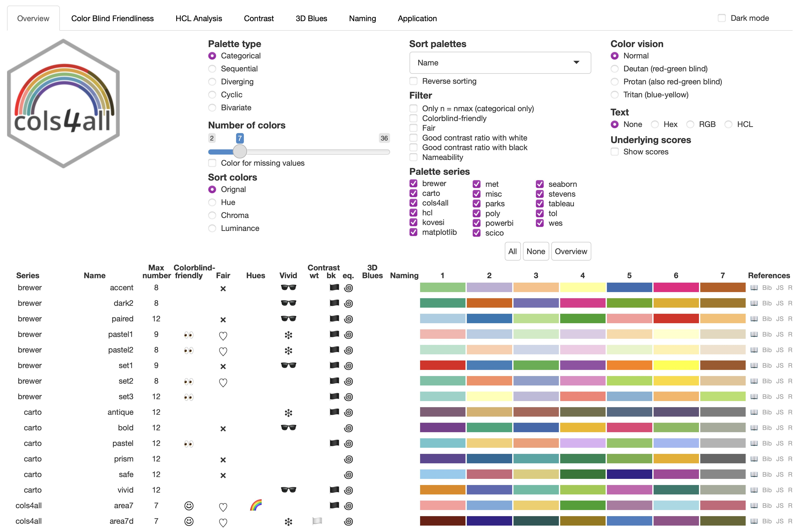

```{r setup, include=F}
library(quarto)
library(fontawesome)
library(tidyverse)
```

## ¿Qué es la identidad visual? {.title-top}

<br>

Se define como identidad visual al conjunto de decisiones de diseño que hacen reconocible a un documento, un equipo o una institución.

::: incremental
- **Paleta de colores**: principal, acento y neutros
- **Tipografía**: una fuente para títulos y otra para el cuerpo
- **Elementos gráficos**: logo, íconos, estilo de gráficos y tablas
- **Espaciado y jerarquía**: qué se destaca y cómo se lee
:::

## ¿Por qué importa en un informe? {.title-top}

<br>

::: incremental
- **Coherencia**: todos los informes del equipo se ven como parte de una misma familia

- **Legibilidad**: buena tipografía y contraste ayudan a leer y a entender

- **Accesibilidad**: contraste suficiente (recomendado ≥ 4,5:1 para texto) y paletas aptas para daltonismo

- **Reutilización**: se define una vez y se aplica a decenas de informes

:::

. . .

> La idea es separar el diseño (constante) del contenido (variable).

## Opciones YAML más relacionadas con lo estético {.title-top}

<br>

| Opción | Qué controla |
|---|---|
| `theme` | Tema Bootswatch y/o archivos SCSS |
| `css` | Hojas de estilo CSS adicionales |
| `title-block-banner` | Banner de color en el título |
| `page-layout` / `grid` | Ancho y distribución de la página |
| `highlight-style` | Colores del código resaltado |
| `code-fold`, `code-copy`, `code-line-numbers` | Presentación del código |
| `df-print` | Aspecto de los data frames |
| `fontsize`, `linestretch` | Tamaño de letra e interlineado |

## Opciones YAML más relacionadas con lo estético {.title-top}

<br>
<br>

```yaml
format:
  html:
    theme: cosmo
    title-block-banner: "#14456b"
    highlight-style: github
```
<br>

- tema Bootswatch **cosmo**
- color de banner titulo *"#14456b"*
- estilo de código resaltado tipo **github**

## Temas Bootswatch para HTML {.title-top}

<br>

Quarto incluye más de 20 temas prearmados, basados en [Bootstrap](https://bootswatch.com/). Se cambian con una sola línea.

<br>

::: {.fragment .fade-in-then-semi-out}
- **Claros**: `cosmo`, `flatly`, `journal`, `lumen`, `litera`, `sandstone`, `yeti`
:::

::: {.fragment .fade-in-then-semi-out}
- **Oscuros**: `darkly`, `cyborg`, `slate`, `solar`, `superhero`, `vapor`
:::

::: {.fragment .fade-in-then-semi-out}
- **Llamativos**: `lux`, `minty`, `pulse`, `sketchy`
:::

## Temas Bootswatch para HTML {.title-top}

<br>

```yaml
format:
  html:
    theme: flatly
```

<br>

Modo claro y oscuro con conmutador:

```yaml
format:
  html:
    theme:
      light: flatly
      dark: darkly
```

## CSS puro vs SCSS {.title-top}

<br>

| | CSS | SCSS |
|---|---|---|
| Cómo se usa | `css: estilos.css` | `theme: [cosmo, mi-tema.scss]` |
| Variables | Limitadas (`--mi-color`) | Variables de Bootstrap (`$primary`, `$body-bg`) |
| Alcance | Se aplica sobre el HTML ya generado | Se compila junto con el tema y cambia todo el sistema |
| Ideal para | Retoques puntuales | Identidad visual completa |

## Archivo SCSS {.title-top}

<br>

Un archivo SCSS de Quarto tiene dos secciones:

```scss
/*-- scss:defaults --*/
$primary: #1b6ca8;
$headings-color: #14456b;

/*-- scss:rules --*/
h2 { border-bottom: 2px solid $primary; }
```

<br>

- `defaults`: valores de las variables, antes de compilar el tema
- `rules`: reglas CSS propias, que pueden usar esas variables

## Importación de fuentes de Google {.title-top}

<br>

1. Elegir la fuente en fonts.google.com y copiar el `@import`
2. Pegarlo en la sección `defaults` del SCSS
3. Asignar la fuente a las variables de Bootstrap

<br>

```scss
/*-- scss:defaults --*/
@import url('https://fonts.googleapis.com/css2?family=Merriweather:wght@400;700&family=Source+Sans+3:wght@400;600&display=swap');

$font-family-sans-serif: "Source Sans 3", "Segoe UI", sans-serif;
$headings-font-family: "Merriweather", Georgia, serif;
```
## Importación de fuentes de Google {.title-top}

<br>

Para tener en cuenta:

- Requiere internet al renderizar y, según la configuración, al abrir el HTML
- Pedir solo los pesos necesarios (variantes de grosor de una misma fuente: la letra puede venir en fina, normal, seminegrita, negrita y se definen como `wght@400;700` por ejemplo) para no ralentizar la carga
- Siempre dejar una fuente de respaldo en la lista
- Alternativa sin internet: archivos locales con `@font-face`

## Temas personalizados para ggplot2 {.title-top}

Los gráficos también son parte de la identidad visual. Se define una vez y se reutiliza.

```r
paleta <- c(principal = "#1b6ca8", acento = "#d95f0e")

theme_proyecto <- function(base_size = 12) {
  theme_minimal(base_size = base_size) +
    theme(
      plot.title       = element_text(face = "bold", colour = "#14456b"),
      panel.grid.minor = element_blank(),
      legend.position  = "bottom"
    )
}

theme_set(theme_proyecto())   # aplica el tema a todos los gráficos
```

- Usar los **mismos colores** que el SCSS para que documento y gráficos se vean integrados
- Para categorías, paletas aptas para daltonismo.
- Guardar el tema y la paleta en un archivo `R/` del proyecto para reutilizarlos en todos los informes

## Colores y paletas para todos: cols4all {.title-top}

{.absolute top="1" left="1900" width="160"}

`cols4all` es un paquete para **elegir paletas de colores con criterios objetivos**, pensado para que los gráficos sean legibles para todas las personas, incluidas las que tienen deficiencia en la visión del color.

- Nombre: *colors for all*
- Organiza paletas de series muy usadas y las **evalúa** según varias propiedades
- Incluye un **panel interactivo** (dashboard) para explorarlas y compararlas
- Trae **escalas listas para ggplot2**
- Autor y mantenedor: Martijn Tennekes (también autor de `tmap`)

```r
install.packages("cols4all", dependencies = TRUE)
library(cols4all)
```
Accesos: sitio del paquete (cols4all.github.io/cols4all-R) y viñeta en CRAN.


## ¿Por qué importa la elección de la paleta? {.title-top}

<br>

- Según la documentación del paquete, alrededor de **1 de cada 12 personas** tiene alguna deficiencia en la visión del color
- Una paleta bonita no es necesariamente una paleta **legible**
- Hay muchas paletas disponibles y solemos quedarnos con las que ya conocemos
- La pregunta central del paquete: **¿qué paletas son buenas y por qué?**

## ¿Qué evalúa cols4all en cada paleta? {.title-top}

<br>

::: {style="font-size: 0.8em;"}
| Criterio | Pregunta que responde |
|---|---|
| **Apta para daltonismo** | ¿Se distinguen los colores con distintos tipos de deficiencia visual? |
| **Análisis HCL** | ¿Qué tan vivos son los colores? ¿Se destacan por igual? |
| **Contraste** | ¿Hay contraste suficiente con el fondo? ¿Hacen falta bordes entre colores? |
| **"3D Blues"** | ¿Hay azules puros que puedan generar un efecto de flotación visual? |
| **Nombrabilidad** | ¿Son colores fáciles de nombrar y recordar? *(en desarrollo)* |

:::

Las paletas reciben etiquetas simples: ☺ apta para daltonismo, 👀 no apta, y sin etiqueta si es intermedia.

## Tipos de paleta {.title-top}

<br>

::: {style="font-size: 0.8em;"}
| Código | Tipo | Cuándo usarla |
|---|---|---|
| `cat` | Categórica | Grupos sin orden (sexo, jurisdicción, clasificación) |
| `seq` | Secuencial | Valores ordenados de menor a mayor (tasas, casos) |
| `div` | Divergente | Valores con punto medio relevante (cambios, desvíos respecto de lo esperado) |
| `biv*` | Bivariada | Dos variables a la vez (mapas) |
:::

<br>

- Todas las secuenciales van **de claro a oscuro**
- Cada paleta trae asignado un **color para valores faltantes** (`c4a_na()`)

## Series de paletas incluidas {.title-top}

<br>

Reúne paletas de series conocidas, organizadas y consistentes entre sí:

`brewer` · `carto` · `hcl` · `kovesi` · `met` · `parks` · `poly` · `scico` · `seaborn` · `tableau` · `tol` · `viridis` · `wes` · `stevens` (bivariadas) y otras

- El nombre de cada paleta lleva el prefijo de su serie: `"brewer.set3"`, `"tol.bright"`, `"hcl.purple_green"`
- Se pueden **cargar paletas propias** y analizarlas con los mismos criterios

## El panel interactivo {.title-top}

<br>

:::: {.columns}

::: {.column width="50%"}

```r
c4a_gui()
```

- Tabla con todas las paletas y sus propiedades
- **Filtros** por tipo, serie, cantidad de colores y aptitud para daltonismo
- **Orden** por criterio (por ejemplo, de más a menos amigable para daltonismo)
- Pestañas con análisis detallado de cada paleta
- Útil para decidir en grupo qué paleta adoptar como identidad visual

:::

::: {.column width="50%"}

{fig-align="center"}

:::
::::

## Funciones principales {.title-top}

| Función | Para qué sirve |
|---|---|
| `c4a_gui()` | Abre el panel interactivo |
| `c4a("serie.nombre", n)` | Devuelve `n` colores de la paleta |
| `c4a_na("serie.nombre")` | Color asociado a valores faltantes |
| `c4a_plot(colores)` | Dibuja la paleta |
| `c4a_palettes(type, series)` | Lista paletas disponibles |
| `c4a_info("serie.nombre")` | Tipo y cantidad máxima de colores de una paleta |
| `c4a_series()` / `c4a_types()` | Series y tipos disponibles |
| `c4a_citation()` | Cómo citar las paletas usadas |

## Primeros pasos {.title-top}

<br>

```r
# ¿Qué paletas divergentes hay en la serie hcl?
c4a_palettes(type = "div", series = "hcl")

# 11 colores de una paleta
c4a("hcl.purple_green", 11)

# Invertir el orden: con el signo menos o con reverse = TRUE
c4a("-hcl.set2", n = 8)

# Verla
c4a("carto.safe", 7) |> c4a_plot()
```

## Integración con ggplot2 {.title-top}

Dos caminos:

**1. Con `scale_fill_manual()` y `c4a()`** (el más simple y transparente)

```r
library(ggplot2)
library(cols4all)

ggplot(datos, aes(grupo_etario, n, fill = sexo)) +
  geom_col() +
  scale_fill_manual(values = c4a("carto.safe", 2))
```

**2. Con las escalas propias del paquete**, que siguen el patrón
`scale_<estética>_<mapeo>_c4a_<tipo>`

```r
scale_fill_discrete_c4a_cat("carto.safe")       # categórica
scale_fill_continuous_c4a_seq("brewer.blues")   # secuencial
scale_color_continuous_c4a_div("hcl.purple_green") # divergente
```

## Buenas prácticas para elegir {.title-top}

<br>

::: incremental
- **Colores pastel** (poco intensos) para áreas grandes: barras, mapas
- **Colores vivos** para elementos pequeños: puntos, líneas, etiquetas
- Categórica: que los colores **se destaquen por igual**, para que ninguno atraiga más atención sin motivo
- Si dos colores tienen brillo similar, usar **bordes** entre ellos
- No depender solo del color: sumar formas, patrones o etiquetas
- Evitar pares problemáticos como rojo-verde sin comprobar la paleta
:::


## Integración con nuestro proyecto

<br>

La paleta se define **una vez** y se reutiliza en documento y gráficos:

<br>

```r
# R/05_tema.R
paleta_sexo <- c4a("carto.safe", 2)
names(paleta_sexo) <- c("F", "M")

# R/04_graficos.R
scale_fill_manual(values = paleta_sexo, 
                  labels = c(F = "Femenino", M = "Masculino"))
```

- Los mismos colores pueden copiarse a las variables de `scss/` (`$primary`, `$acento`)
- Con `c4a_na()` se define el color de los valores faltantes
- Con `c4a_citation()` se cita correctamente la paleta usada en publicaciones

## Resumen: cada capa en su lugar {.title-top}

<br>

| Qué | Dónde |
|---|---|
| Elección del tema y opciones generales | `_quarto.yml` |
| Colores, fuentes y reglas de estilo | `scss/` |
| Estilo de gráficos | `R/05_tema.R` (o similar) |
| Contenido | `.qmd` |
